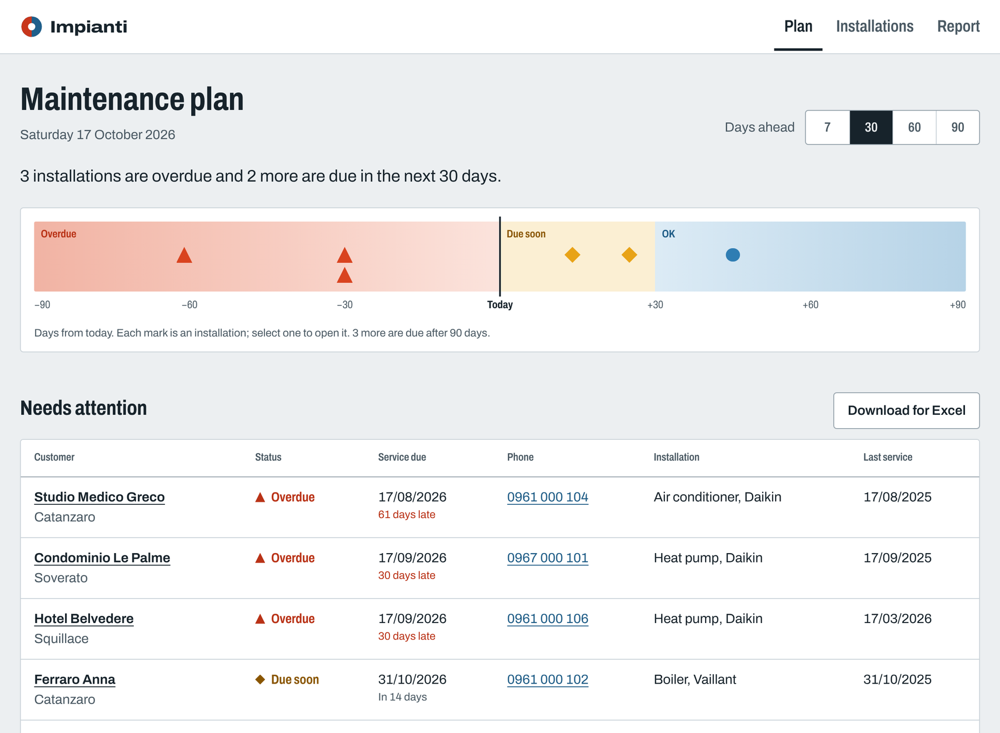

# ImpiantiTracker

Maintenance tracking for a heating and air-conditioning company. It keeps track of customers, their installations (boilers, heat pumps, air conditioners, pellet stoves, solar thermal) and every service visit, and works out which installations are **overdue for maintenance** or due soon.

There are three ways in, all sharing the same business rules and database:

- **Web app** in `web/`: SvelteKit 3, Svelte 5 and TypeScript, for the office and for technicians on their phones.
- **HTTP API** in `src/ImpiantiTracker.Api`: ASP.NET Core minimal API with OpenAPI.
- **Command-line tool** in `src/ImpiantiTracker.Cli`.

The back end is built with **C# 14 / .NET 10**, **Entity Framework Core 10** and **SQL Server** (or SQLite for a quick local run). It's tested with **xUnit**, the web app with Vitest and browser tests.

> **In breve:** gestionale per una ditta termoidraulica. Registra clienti, impianti e interventi, e calcola quali impianti sono in ritardo con la manutenzione o in scadenza. Web app SvelteKit, API ASP.NET Core, riga di comando; C#/.NET 10, Entity Framework Core, SQL Server.



```
$ dotnet run --project src/ImpiantiTracker.Cli -- due
ID  Status    Due         When       Customer             City       Phone         Type             Last service
--  --------  ----------  ---------  -------------------  ---------  ------------  ---------------  ------------
5   OVERDUE   16/08/2026  61 d late  Studio Medico Greco  Catanzaro  0961 000 104  Air conditioner  16/08/2025
1   OVERDUE   16/09/2026  30 d late  Condominio Le Palme  Soverato   0967 000 101  Heat pump        16/09/2025
7   OVERDUE   16/09/2026  30 d late  Hotel Belvedere      Squillace  0961 000 106  Heat pump        16/03/2026
2   Due soon  30/10/2026  in 14 d    Ferraro Anna         Catanzaro  0961 000 102  Boiler           30/10/2025
6   Due soon  10/11/2026  in 25 d    Mancuso Luca         Satriano   0967 000 105  Boiler           never

3 overdue, 2 due within 30 days (as of 16/10/2026).
```

The sample data is fictional, and its dates are relative to the day you run it, so the plan always shows something to act on.

## Run the web app

You need the .NET 10 SDK and Node.js 22.17 or newer. In one terminal, start the API (it creates the database and sample data on first run):

```sh
dotnet run --project src/ImpiantiTracker.Api
```

In a second terminal:

```sh
cd web
npm ci
npm run dev
```

Open http://localhost:5173.

| Page | What it's for |
| --- | --- |
| Plan | What's overdue or due in the next 7, 30, 60 or 90 days; tap-to-call phone numbers; download for Excel |
| Installations | Every installation with its status, filtered by city or searched by name |
| Installation | Next service date, history, and a form to record a visit (works without JavaScript too) |
| Report | Visits and revenue for a year, by month, technician and type of visit |

In SQLite mode the API and the CLI share the same `impianti.db` in the repository root, so a visit recorded in one shows up in the other.

## The API

| Method and path | Returns |
| --- | --- |
| `GET /api/maintenance?days=30&all=false` | The maintenance plan, most urgent first |
| `GET /api/maintenance/export?days=30&all=false` | The same plan as a CSV file for Excel |
| `GET /api/installations?city=Catanzaro` | Installations with customer and last visit |
| `GET /api/installations/{id}` | One installation with customer, history and maintenance status |
| `POST /api/installations/{id}/visits` | Records a visit: `201` with the new due date, `400` with every validation problem, or `404` |
| `GET /api/reports/{year}` | Visits and revenue by month, technician and type |
| `GET /health` | `Healthy` |
| `GET /openapi/v1.json` | The OpenAPI description (in Development) |

Errors come back as standard problem details (RFC 9457). Sample requests are in `src/ImpiantiTracker.Api/ImpiantiTracker.Api.http`; open it in VS Code with the REST Client extension, or in Rider.

## CLI commands

| Command | What it does |
| --- | --- |
| `init` | Create the database and load the sample data (safe to re-run) |
| `reset --yes` | Delete everything and start again |
| `list [--city <name>]` | Installations with customer and last visit |
| `show <id>` | One installation with its full visit history and next due date |
| `due [--days N] [--all]` | Maintenance plan: overdue first, then due within N days (default 30) |
| `add-visit --installation <id> --kind <maintenance\|rcee\|repair> --tech <name> [--date] [--cost] [--notes]` | Record a visit; prints the new due date |
| `report [--year YYYY]` | Visits and revenue by month, technician and visit type |
| `export <file.csv> [--days N] [--all]` | The plan as a CSV that Excel opens correctly (`;` separated, UTF-8) |

Dates can be typed as `2026-10-16` or `16/10/2026`, amounts as `80,50` or `80.50`. Visit kinds accept the Italian words too (`manutenzione`, `riparazione`).

## Run the CLI (SQLite, about 2 minutes)

1. Install the .NET 10 SDK: `brew install --cask dotnet-sdk`, or download it from [dotnet.microsoft.com](https://dotnet.microsoft.com/download/dotnet/10.0). Check with `dotnet --version` (10.0.x).
2. From this folder:

```sh
dotnet run --project src/ImpiantiTracker.Cli -- init
dotnet run --project src/ImpiantiTracker.Cli -- due
dotnet run --project src/ImpiantiTracker.Cli -- show 1
dotnet run --project src/ImpiantiTracker.Cli -- add-visit --installation 1 --kind manutenzione --tech "K. Kier" --cost 140
dotnet run --project src/ImpiantiTracker.Cli -- report
```

The database is a single file, `impianti.db`, in the folder you run from. To type less, add an alias (works in zsh, bash and fish): `alias impianti="dotnet run --project src/ImpiantiTracker.Cli --"`, then `impianti due`.

## Run it on SQL Server (Docker)

1. In Docker Desktop on an Apple Silicon Mac, turn on *Settings > General > Use Rosetta for x86_64/amd64 emulation*.
2. Start SQL Server 2022 and wait until it reports `healthy`:

```sh
docker compose up -d
docker compose ps
```

3. Point the CLI or the API at it with an environment variable (the `env` form works in every shell, fish included):

```sh
env IMPIANTI_Database__Provider=SqlServer dotnet run --project src/ImpiantiTracker.Cli -- init
env IMPIANTI_Database__Provider=SqlServer dotnet run --project src/ImpiantiTracker.Cli -- due
env IMPIANTI_Database__Provider=SqlServer dotnet run --project src/ImpiantiTracker.Api
```

On SQL Server, the database is created by the EF Core migrations in `src/ImpiantiTracker.Data/Migrations` (the CLI's `init`, or the API at startup). Settings live in each project's `appsettings.json`; any of them can be overridden with an `IMPIANTI_` environment variable (`:` becomes `__`). The password in the repo is for local development only.

## SQL practice scripts

The `sql/` folder is mounted into the container. Run a script with:

```sh
docker exec -it impianti-sqlserver /opt/mssql-tools18/bin/sqlcmd -S localhost -U sa -P 'Impianti_Dev_2026!' -C -i /sql/01-maintenance-plan.sql
```

| Script | Shows |
| --- | --- |
| `00-schema-generated.sql` | The T-SQL that the EF migration runs (generated, don't edit) |
| `01-maintenance-plan.sql` | The due-date rule as a view: CTE, `LEFT JOIN`, `DATEADD`, `CASE` |
| `02-yearly-report.sql` | `GROUP BY`, `ROLLUP` for totals, sargable date ranges, `TOP` |
| `03-reporting-user.sql` | A read-only login with least privilege and ownership chaining |
| `04-backup-restore.sql` | Full backup with checksum, `VERIFYONLY`, restore into a copy, check, clean up |

To browse the database with a GUI, use the *SQL Server (mssql)* extension in VS Code: server `localhost`, user `sa`, the password above, "Trust server certificate" on.

## Tests

```sh
dotnet test
cd web && npm run check && npm test
```

- **Business rules and CLI (72 tests):** the maintenance rules, visit validation, CSV escaping, the report, the argument parser, and the database queries.
- **API (21 tests):** the whole HTTP pipeline (routing, binding, JSON, status codes, problem details, CSV headers) through `WebApplicationFactory`, on a fixed date.
- **Web (34 unit tests):** date, money and phone formatting, and parsing what people type.

Every database test runs against a real SQLite database held in memory: real SQL and real constraints, no files, nothing to clean up.

## Project layout

```
src/
  ImpiantiTracker.Core/       Domain classes and business rules. No NuGet packages, no database code.
  ImpiantiTracker.Data/       EF Core: DbContext and mapping, migrations, seed data, queries (TrackerService).
  ImpiantiTracker.Api/        ASP.NET Core minimal API over TrackerService.
  ImpiantiTracker.Cli/        The console app: settings, argument parsing, tables, CSV export.
tests/
  ImpiantiTracker.Tests/      xUnit tests for Core, Data and the CLI.
  ImpiantiTracker.Api.Tests/  Integration tests for the API.
web/                          SvelteKit app (see web/README.md).
sql/                          T-SQL scripts for SQL Server practice.
```

```
Browser ──> SvelteKit server (web/) ──> ASP.NET Core API ──┐
                                                           ├──> TrackerService ──> EF Core ──> SQL Server / SQLite
                        Command line (CLI) ────────────────┘
```

## Design notes

- **Rules separate from storage.** The due-date logic in `MaintenanceSchedule` is pure C#: no database, and "today" is always passed in, so every rule is tested with fixed dates.
- **Mapping in one place.** The domain classes carry no EF attributes; `AppDbContext` maps them with the Fluent API: lengths, decimal precision, enums stored as text, a check constraint, a unique index (filtered on SQL Server so missing serial numbers don't clash).
- **One query per screen.** The plan loads every installation with the date of its last routine service in a single SQL statement (a correlated subquery), read-only with `AsNoTracking`. Repairs are excluded, because a repair is not a service.
- **Two providers.** SQL Server is the production target and uses migrations; SQLite makes the app run anywhere in seconds and keeps the tests fast.
- **Italian details.** Dates shown as dd/MM/yyyy, euro amounts as `1.234,50 €`, and CSV with `;` and a byte-order mark, because Excel in Italian expects both.
- **Versions in one file.** NuGet versions are pinned in `Directory.Packages.props`, including a patched version of a vulnerable package that SQL Server's driver pulls in.
- **One service, three front doors.** The CLI and the API both call `TrackerService`, so a rule can't drift between them. The API maps entities to response records instead of returning them, and enums travel as text (`"Overdue"`, not `2`).
- **The browser only talks to SvelteKit.** Pages load their data on the server and call the API from there, so the API needs no CORS and its address isn't exposed. Pages render without JavaScript, and the visit form works as a plain HTML form.

Possible next steps: user authentication, reminders sent to customers when their service is due, and a Dockerfile for the API and web app.

## Changing the database schema

```sh
dotnet tool restore
dotnet ef migrations add <Name> --project src/ImpiantiTracker.Data --startup-project src/ImpiantiTracker.Cli
dotnet ef migrations script --idempotent --project src/ImpiantiTracker.Data --startup-project src/ImpiantiTracker.Cli -o sql/00-schema-generated.sql
```
